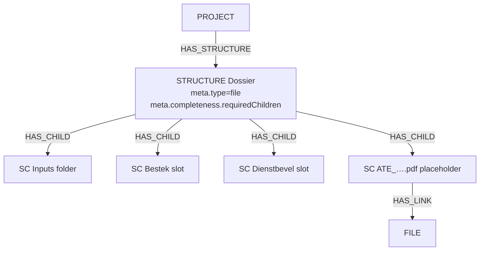

# Architecture – Structure-level metadata (completeness & visualization)

**Status:** Proposed  
**Related:** [Checklist options](dossier-completeness-checklist-options.md), [Domain model – Epic 2](domain-model.md#epic-2-dossier-profile)  
**User stories:** [Structure metadata user stories](epics/epic-1-structure-metadata-user-stories.md)

## 1. Problem

A `STRUCTURE` with `meta.type = "file"` organises the project dossier as a tree of `STRUCTURE_CHILD` nodes. The tree alone cannot answer if the dossier is complete, since there is no structure determining the expected behaviour the the different `STRUCTURE_CHILD` nodes.

Inferring “leaf = required” from path depth or “has children” is unreliable (empty folders, file placeholders, colliding WBS tokens).

## 2. Decision

Use a **namespaced metadata object on the STRUCTURE** (`structure.meta`), keyed by concern, `meta.completeness`. This metadata object describes which `STRUCTURE_CHILD` nodes should contain one or more files.

This approach can later be extended for other concerns, like how to visualize certain nodes.

Child-level `role` / `isFolder` may still be introduced later for per-node semantics; **v1 completeness does not depend on them**. Completeness is driven only by `meta.completeness`.

**Rejected for v1 completeness**

- Separate LIST checklist (valid alternative as described in vnv-doc/vnv-doc-content/docs/analyse/dossier-completeness-checklist-options.md, this approach is not chosen here)
- Equating “not a folder” with “required slot”, where all nodes that aren't a folder require a file for dossier completeness.

## 3. Extensible meta shape

Today `StructureMetadata` includes `type`, `children`, `description`, … Completeness is a **sibling object** so new concerns can be added without colliding with `type` or the organizational `children` array.

```ts
// Conceptual — to add to StructureMetadata (SDK)
completeness: z.object({
  version: z.string().optional(),           // profile / checklist version label
  requiredChildren: z.array(z.object({
    token: z.string(),                      // STRUCTURE_CHILD.token (stable id)
    child: z.string().optional(),           // dotted path, denormalized for display
    name: z.string().optional(),            // label override for report/UI
    obligation: z.enum(["mandatory", "optional", "excluded"])
      .optional().default("mandatory"),
    // Reserved for Epic 2 overlay (not required for first report):
    phase: z.string().optional(),
    documentType: z.string().optional(),
  })).default([]),
}).optional(),

```

### Example (file dossier)

```json
{
  "type": "file",
  "description": "Project dossier",
  "children": [ /* full organizational tree — unchanged */ ],
  "completeness": {
    "version": "1.0",
    "requiredChildren": [
      {
        "token": "STR2025-028-001.Dossier-Bestek",
        "child": "1.2",
        "name": "Bestek",
        "obligation": "mandatory"
      },
      {
        "token": "STR2025-028-001.Dossier-Dienstbevel",
        "child": "1.1",
        "name": "Dienstbevel",
        "obligation": "mandatory"
      },
      {
        "token": "STR2025-028-001.Dossier-Notulen",
        "child": "5.1",
        "name": "Notulen",
        "obligation": "optional"
      }
    ]
  }
}
```

## 4. Graph model

Completeness does **not** add new node labels. The checklist is JSON on the STRUCTURE; the tree and files stay as today.



`meta.completeness.requiredChildren` references `bestek` and `dienst` by **token**. Presence of a document for a slot is evaluated via graph (see §5).

## 5. Presence rules (completeness evaluation)

For each entry in `completeness.requiredChildren` with `obligation !== "excluded"`:

| Rule | Meaning |
|------|---------|
| **Present** | The referenced `STRUCTURE_CHILD` has `HAS_LINK` → `FILE`, **or** (product default) a **direct** child of that slot has `HAS_LINK` → `FILE` (file placeholder pattern) |
| **Missing** | Mandatory entry with no FILE via the rule above |
| **Optional empty** | `obligation === "optional"` and no FILE — shown, not a blocker |
| **Excluded** | Ignored by completeness / report blockers |

## 6. Report (`REP-VERPLICHTE-DOCS`)

1. Match `PROJECT` → `STRUCTURE` where `meta.type = "file"` (project filter as today).
2. Read `meta.completeness.requiredChildren` (empty array → empty report or “checklist not configured”).
3. For each entry (skip `excluded`): resolve node by `token`, resolve FILE per §5.
4. Return columns: project, structure name, slot name/path/token, obligation, presence status, file fields.
5. Do **not** list every structure child — only checklist entries.

Engine may need a small DSL extension to unwind JSON arrays from meta, **or** a dedicated post-process / Cypher helper for this report until the DSL supports it. Prefer one reusable “completeness query” path shared by report and future `structure.isComplete()` / ReadinessCheck.
