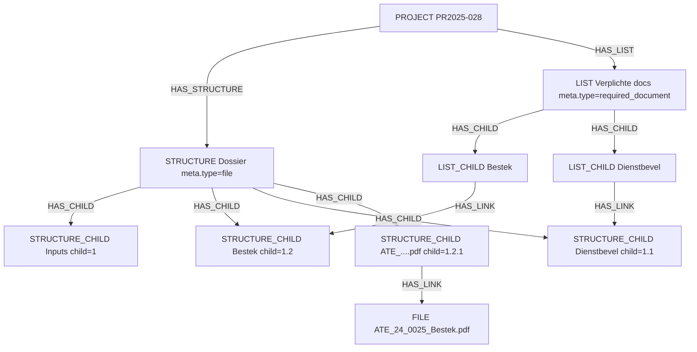
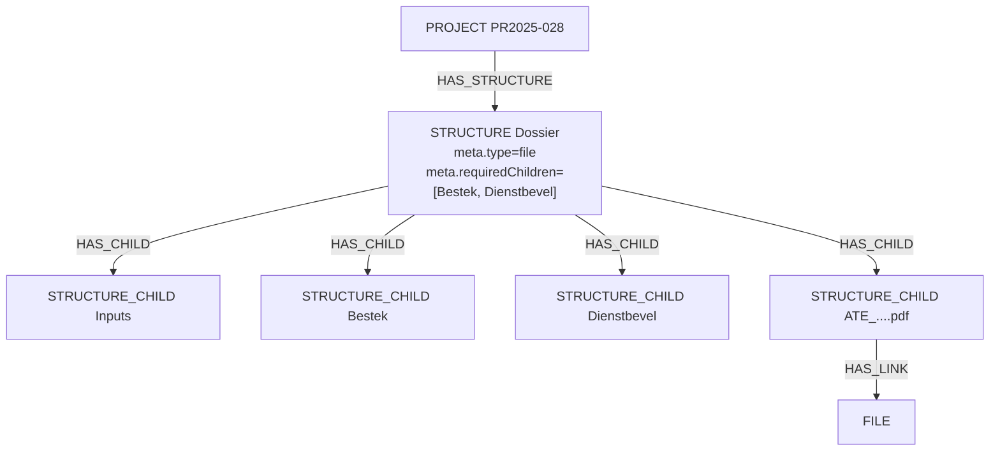
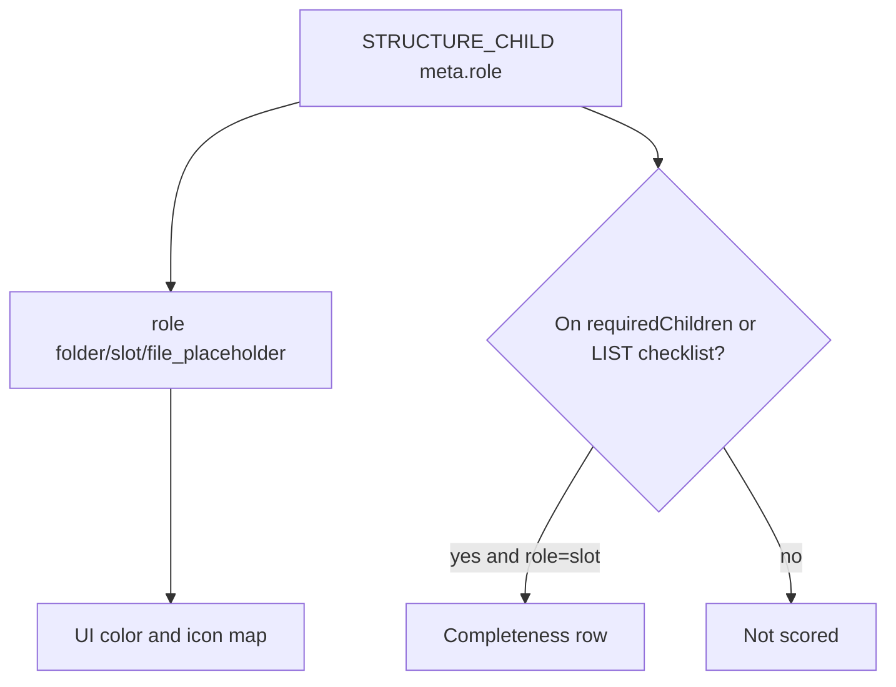

**Chosen approach (structure-level metadata):** see [Architecture – Structure-level metadata](architecture-structure-level-metadata.md) and [user stories](epics/epic-2-structure-metadata-user-stories.md). Completeness uses `structure.meta.completeness`; visualization uses `structure.meta.visualization` (follow-on). The LIST checklist below remains a documented alternative.

---

# Dossier completeness — checklist options

**Problem.** A file `STRUCTURE` organizes `STRUCTURE_CHILD` nodes. The tree alone cannot tell an empty **folder** from an empty **required document slot**, so a report cannot answer “is the dossier complete?” without an explicit checklist of required slots.

**Idea** Keep the dossier tree as organization. Define **what must be filled** separately. Completeness = every checklist entry has a linked `FILE` on the corresponding structure child (attachment rule TBD: file on the slot itself vs on a placeholder child).

Two concrete shapes:

1. **LIST as checklist** (first-class graph)
2. **`structure.meta.requiredChildren`** (JSON on the dossier STRUCTURE)

---

## Option A — LIST as checklist

Reuse existing `LIST` / `LIST_CHILD` / `HAS_CHILD` / `HAS_LINK`.

| Piece | Role |
|-------|------|
| `LIST` with `meta.type = "required_document"` | Checklist container (found by type and/or token) |
| `LIST_CHILD` | One required slot (business label) |
| `LIST_CHILD` → `HAS_LINK` → dossier `STRUCTURE_CHILD` | Points at the slot that must be filled |
| Dossier `STRUCTURE_CHILD` → `HAS_LINK` → `FILE` | Actual document (unchanged) |

### Example graph



### Notes

- **Inputs** is only in the dossier tree — not on the checklist → ignored for completeness.
- **Bestek** / **Dienstbevel** are checklist targets → report rows.
- Colliding WBS paths stay on the STRUCTURE only; checklist links name the intended Dossier children by token.
- Report path: `PROJECT` → `LIST` → `LIST_CHILD` → `STRUCTURE_CHILD` → optional `FILE`.

### Completeness

| Checklist entry | Linked dossier child has FILE | Status |
|-----------------|-------------------------------|--------|
| Yes | Yes | Present |
| Yes | No | Missing |
| Not on checklist | — | Out of scope |

---

## Option B — `structure.meta.requiredChildren`

Checklist lives **on the dossier STRUCTURE** metadata (no second stack).

Extend structure meta (alongside `type`, `children`, …), for example:

```ts
requiredChildren: z.array(z.object({
  token: z.string(),            // STRUCTURE_CHILD.token
  child: z.string().optional(), // path "1.2"
  name: z.string().optional(),  // label for report/UI
})).optional().default([])
```

### Example meta on Dossier (`meta.type = "file"`)

```json
{
  "type": "file",
  "description": "Project dossier",
  "children": [],
  "requiredChildren": [
    {
      "token": "STR2025-028-001.Dossier-Bestek",
      "child": "1.2",
      "name": "Bestek"
    },
    {
      "token": "STR2025-028-001.Dossier-Dienstbevel",
      "child": "1.1",
      "name": "Dienstbevel"
    }
  ]
}
```

(`children` in real data holds the full organizational tree; omitted here for brevity.)

### Example graph (same dossier tree; checklist is JSON, not edges)



`requiredChildren` references `bestek` and `dienst` by **token inside meta**, not via a separate LIST.

### Semantics

- Tree (`HAS_CHILD`) = full organization (folders + slots + file placeholders).
- `requiredChildren` = only slots that must have a linked `FILE`.
- Folders (e.g. Inputs) stay out of the array.
- Report: load STRUCTURE → unwind `requiredChildren` → match child by token → optional FILE.
- Maintain tokens on rename/delete of structure children to avoid stale JSON.

---

## Comparison

| | LIST checklist (A) | `meta.requiredChildren` (B) |
|--|--------------------|-----------------------------|
| Extra stack | Yes (`LIST` + `LIST_CHILD`) | No |
| Edit UX | List tab + link to slot | Toggle / editor on structure |
| Report | Graph join list → child → file | Unwind meta → child → file |
| Graph purity | First-class links | Checklist is JSON |
| Drift risk | Broken links visible | Tokens can go stale if not cleaned |

---

## Separating concerns: node role / presentation vs required documents

Three different questions:

| Concern | Question | Scope |
|---------|----------|--------|
| **Node kind / role** | What kind of child is this (folder, slot, file placeholder, …)? | All structure types; drives UI color/icon and link rules |
| **Presentation** | How should this role (or other rules) look? | Theme / treeview mapping |
| **Required document** | Must this child be filled for dossier completeness? | File dossier reporting only |

**Do not reuse `requiredChildren` for colors.** That list answers completeness. Presentation needs something that applies to every child (or every role), not only required slots.

### Better than a bare `isFolder` boolean: `role` (or `kind`) on the child

`isFolder: true|false` only encodes one bit. A small enum on `structure_child.meta` is more flexible and still local to the node:

```ts
// structure_child.meta
role: z.enum([
  "folder",           // organizational branch
  "slot",             // leaf intended to hold a linked item (file/work/…)
  "file_placeholder", // leaf that is the attached file node under a slot
  // extend later: "milestone", "section", …
]).optional().default("slot")
```

| Role | Typical UI | Completeness |
|------|------------|--------------|
| `folder` | Branch color | Never required by itself |
| `slot` | Leaf color | Only if also on checklist |
| `file_placeholder` | Leaf / file color | Not a checklist row (parent slot is) |

UI maps **role → color/icon** in one place (treeview theme). New behaviors = new roles or presentation rules, without overloading completeness metadata.

`isFolder` can remain as a derived helper (`role === "folder"`) for backward compatibility, or be replaced by `role` over time.

### “Lists like `requiredChildren`” — when they help

Token lists on **structure.meta** are good for **sparse, explicit sets**:

- `requiredChildren` → completeness checklist  
- Maybe later: `pinnedChildren`, `reviewQueue`, …

They are a poor fit as the **primary** driver of leaf colors:

- You would need a list (or many lists) that includes **every** leaf and folder, or colors fall back to heuristics again  
- Drift: every add/move/delete updates JSON arrays  
- Same concern appears on WBS/RBS structures that never have `requiredChildren`

Prefer:

1. **Role on each child** (semantic, travels with the node)  
2. **Presentation map** in UI or structure views: `role → { color, icon }`  
3. **Optional** structure-level lists only for special subsets (required docs, pins)



### Why not equate “not folder” with “required slot”?

- Other structures need roles/colors without dossier requirements.  
- Optional slots are normal.  
- File placeholders are often leaves but are not the required checklist entry.  
- Defaulting every new child to “required” is error-prone.

### Practical rule of thumb

| Child meta / membership | UI | Completeness |
|-------------------------|----|--------------|
| `role: folder` | Branch color | Out |
| `role: slot`, not on checklist | Leaf color | Optional |
| `role: slot`, on checklist | Leaf color | Required row |
| `role: file_placeholder` | File/leaf color | Out (file hangs off placeholder or slot per product rule) |

Wire treeview to **role → presentation**. Wire `REP-VERPLICHTE-DOCS` only to the **checklist**. Keep those pipelines independent.

---

## Related

- Template-dossier matching or hard-coded report slot lists (other option-2 variants).
- Migrating existing trees: backfill `role` from “has children” → `folder`, else `slot`; build checklist from known required leaves; treat file-linked name nodes as `file_placeholder` where detectable.
