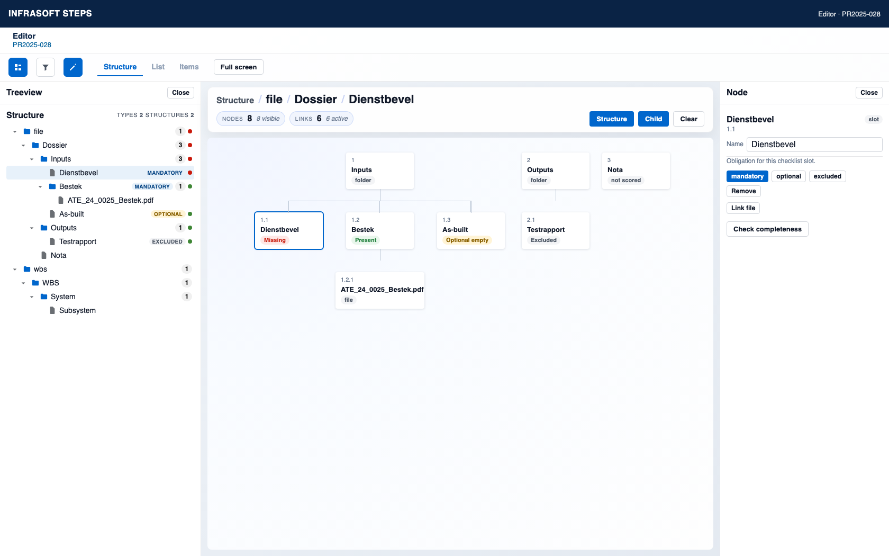

# Epic 1 – User stories: structure-level completeness metadata

**Architecture:** [Structure-level metadata](../architecture-structure-level-metadata.md)  

Stories below assume the **structure-level** approach: required slots live in `structure.meta.completeness.requiredChildren`. 

---

## Configuration

A **checklist node** is a structure child whose token is listed in `meta.completeness.requiredChildren`. Its badge is **mandatory**, **optional**, or **excluded**. 

### US-C01 – View required documents checklist {#us-c01}

**As a** system engineer  
**I want** to open the dossier structure and see which children are on the required-documents checklist  
**so that** I know what completeness will score.

**Mockup:** [Structure tree and node drawer](figs/dossier-completeness-click-model.png)

**Domain:** [Completeness reads](../dossier-completeness-reads.md)

**Acceptance criteria**

- On a file STRUCTURE, each checklist node in the tree shows a badge: **mandatory**, **optional**, or **excluded**.
- A dot next to the child count covers that node and every node under it, at any depth. The root, or any branch, is red when a mandatory slot under it is missing a file, whether that slot is the node itself or several layers below. The dot is green when every mandatory slot in that branch has a file. An optional empty slot and an excluded slot leave the dot green.
- A badge appears only on the node that is itself on the checklist. A node whose branch contains no checklist entry has no dot.
- A checklist token that matches no child turns the file structure’s dot red.
- An empty checklist shows no badges and no dots. The node drawer tells the user to mark slots as required.

---

### US-C02 – Mark a structure child as required {#us-c02}

**As a** system engineer  
**I want** to mark a dossier slot as a required document  
**so that** it appears in completeness check on the structure and in the Verplichte documenten report.

**Mockup:** [Structure tree and node drawer](figs/dossier-completeness-click-model.png)

**Domain:** [Checklist commands](../dossier-completeness-checklist-commands.md) — `setChecklistObligation`

**Acceptance criteria**

- Selecting a node in the structure opens the existing node drawer.
- On a structure of type `file`, that drawer marks the selected node as required, optional, or excluded. The checklist entry is `{ token, child, name, obligation }` with that obligation, and the node shows the matching badge.
- Re-marking the same token is idempotent (no duplicate).
- Save persists `meta.completeness` on the structure.

---

### US-C03 – Change obligation (mandatory / optional / excluded) {#us-c03}

**As a** system engineer  
**I want** to set a checklist entry to mandatory, optional, or excluded  
**so that** completeness and the report respect project overrides.

**Mockup:** [Structure tree and node drawer](figs/dossier-completeness-click-model.png)

**Domain:** [Checklist commands](../dossier-completeness-checklist-commands.md) — `setChecklistObligation`

**Acceptance criteria**

- The node drawer is the only place to set **mandatory**, **optional**, or **excluded**.
- The tree badge updates to the chosen obligation.
- Mandatory missing counts as incomplete and turns the node’s dot red.
- Optional empty stays listed, is not a blocker, and leaves the dot green.
- Excluded is omitted from completeness blockers and from default report rows, and leaves the dot green.

---

### US-C04 – Remove a child from the checklist {#us-c04}

**As a** system engineer  
**I want** to remove a slot from the required-documents checklist  
**so that** it is no longer scored for completeness.

**Mockup:** [Structure tree and node drawer](figs/dossier-completeness-click-model.png)

**Domain:** [Checklist commands](../dossier-completeness-checklist-commands.md) — `removeChecklistEntry`

**Acceptance criteria**

- **Remove** in the node drawer deletes the entry by token from `requiredChildren`.
- The structure child remains in the tree. Its badge and completeness dot disappear.
- Report and completeness UI stop listing that token.

---

### US-C05 – Checklist stays in sync on rename / repath {#us-c05}

**As a** system engineer  
**I want** checklist labels and paths to update when I rename or move a structure child  
**so that** the report stays readable without reconfiguring.

**Domain:** [Structure child commands](../dossier-completeness-child-commands.md) — `updateStructureChild`

**Acceptance criteria**

- On child `name` or `child` (path) change, matching `requiredChildren` entry (same `token`) updates denormalized `name` / `child`.
- Token identity is preserved.

---

### US-C06 – Checklist cleaned on delete {#us-c06}

**As a** system engineer  
**I want** deleting a structure child to remove or block stale checklist references  
**so that** completeness never points at missing tokens.

**Domain:** [Structure child commands](../dossier-completeness-child-commands.md) — `deleteStructureChild`

**Acceptance criteria**

- Deleting a child that is on the checklist removes that entry from `requiredChildren` in the same operation, **or** blocks delete until the user removes it from the checklist (choose one; prefer auto-remove with undo toast).
- No orphan tokens remain after a successful delete.

---

### US-C07 – Duplicate structure copies completeness {#us-c07}

**As a** system engineer  
**I want** duplicating a file structure to copy its completeness checklist onto the new structure  
**so that** the copy scores the same slots as the original.

**Domain:** [Duplicate file structure](../dossier-completeness-duplicate-structure.md)

**Acceptance criteria**

- **Duplicate structure** copies `meta.completeness` onto the new structure in the same project.
- `requiredChildren` on the copy use the **new** child tokens. Each entry still names the same slot.
- An empty checklist on the source stays empty on the copy.
- The copy does not stay linked to the source checklist. Editing one does not change the other.

---

## Completeness & reporting

### US-R01 – See missing mandatory documents in the UI {#us-r01}

**As a** programme manager or system engineer  
**I want** to see which mandatory checklist slots lack a linked file  
**so that** I can chase missing dossier documents.

**Mockup:** [Check completeness and its result](figs/dossier-completeness-result.png)

**Domain:** [Completeness reads](../dossier-completeness-reads.md) — `completeness()`

**Acceptance criteria**

- Completeness view/action lists mandatory entries with status Present / Missing (and optional empty separately).
- Only `completeness.requiredChildren` are evaluated — not every tree leaf.
- Presence follows architecture §5 (FILE on node or direct placeholder child).

---

### US-R02 – Generate Verplichte documenten report from checklist {#us-r02}

**As a** system engineer  
**I want** the Verplichte documenten report to list only configured required slots and their files  
**so that** the export matches the dossier profile.

**Technical addendum:** [Dossier completeness query](../dossier-completeness-query.md)

**Domain:** [Completeness reads](../dossier-completeness-reads.md) — `verplichteDocumenten()`

**Acceptance criteria**

- Report rows correspond 1:1 to non-excluded `requiredChildren` entries for the project’s file STRUCTURE(s).
- Columns include node identity (name/path/token), obligation, presence, and file fields when present.
- Missing mandatory nodes appear with empty file columns and a clear missing status.
- Empty checklist → empty state message, not the full structure dump.
- Generation uses the completeness query in US-R04. It is not a List Report match over the structure tree.

---

### US-R03 – Link file updates presence {#us-r03}

**As a** system engineer  
**I want** linking a file into a required node (or its placeholder child) to mark that node as present  
**so that** UI and report reflect reality without reconfiguration.

**Domain:** [Link a file into a dossier slot](../dossier-completeness-link-file.md)

**Acceptance criteria**

- After `HAS_LINK` to FILE on the slot or direct child placeholder, completeness and report show Present for that checklist token.
- Unlinking the file returns status to Missing (if mandatory) or optional empty.

---

### US-R04 – Completeness query expands the checklist into rows {#us-r04}

**As a** system engineer  
**I want** one completeness query to turn the checklist into rows and resolve each file  
**so that** the Verplichte documenten report and the completeness screen show the same result.

**Technical addendum:** [Dossier completeness query](../dossier-completeness-query.md)

**Domain:** [Completeness reads](../dossier-completeness-reads.md) — `completeness()`

**Acceptance criteria**

- The current List Report DSL cannot produce this report. A query returns one row per matched node. A filter field may only be `alias.property` or `alias.meta.property`, so `meta.completeness.requiredChildren` cannot be unwound in the query. Report execution copies return fields onto those rows and does not run a post-process step. Metrics post-processing cannot do this either: the file link is a graph walk that has to happen while the checklist entry is known.
- The completeness query reads `meta.completeness.requiredChildren` on each file STRUCTURE in the project filter.
- It returns one row per entry whose obligation is not `excluded`.
- Each row resolves the structure child by `token` and the FILE by architecture §5: `HAS_LINK` on the slot, or on a direct placeholder child.
- Columns match architecture §6: project, structure name, slot name, path, token, obligation, presence, and file fields. A missing file leaves the file columns empty.
- An empty `requiredChildren` array returns no slot rows and the “checklist not configured” outcome.
- The query does not list every structure child.
- US-R01 and `REP-VERPLICHTE-DOCS` both call this query. A later `structure.isComplete()` / ReadinessCheck uses the same query.

---