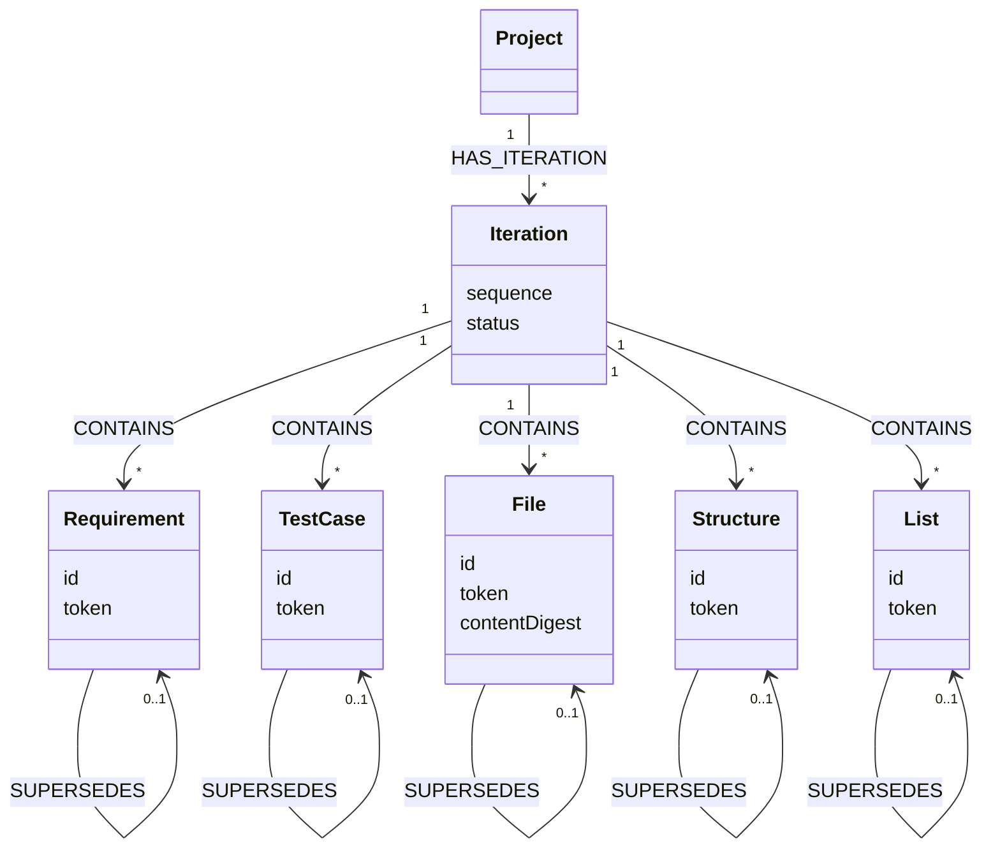

# Iterations

## Need

During a V&V iteration, changes to requirements, test cases, files, structures, and lists result in an overwrite of those items. However, over multiple iterations, requirements, test cases, files and structures can change and evolve.

Since an iteration has to stay explainable after it's closed (it should be clear what was reviewed, tested, ...), it needs to be known what that requirement, test case, file, structure or list was at the time of the review, test, ... . A closed iteration is therefore read-only. A correction is an update on the new node in the open iteration.

So there is a need to make a distinction between overwrite operations and iteration operations.

The next iteration does not always continue with all items of the previous round. A file can be left behind, and a structure or a list can be copied forward or left in the closed round. A requirement can drop out when no carried test case covers it. A test case that is kept brings each requirement it covers, even when that requirement was not added. The person builds that set in the editor, with Add to next iteration on the current search and selection. Opening the next iteration carries that set.

Project creation results in the automatic creation of the first iteration. Projects that already exist need a migration to create that first iteration.

## Behaviour

| Moment | What happens |
|--------|----------------|
| Project is created | Iteration 1 is created with it and is open. There is nothing to choose. |
| Work inside the open iteration | The operation for that type replaces its own content. Same `id`, same token. A structure or list edit replaces that stack in place, children included. |
| Iteration 2, 3, … is opened | The next iteration takes the requirements, test cases, files, structures, and lists the user added to its input. |
| That choice is confirmed | Each chosen item stays in the closed iteration, same `id`, same token, same edges. The open iteration receives a new node: same token, new `id`, content copied from the item. A chosen structure or list is copied with its children. Items that were not chosen stay in the closed iteration, with no new node. |
| Work in the new iteration | Changes update the new version. Same token. The node in the closed iteration stays as it was. |

## Domain

`status` is `open` or `closed`. `sequence` starts at 1 and is shown in the UI to identify the iteration. An item created in iteration 3 is that iteration’s node of the token.

The `id` determines the exact node version. The `token` determines the semantics of the requirement, test case, file, structure, or list, assigned once by the create operation for that type. Each later node of that item has a new `id` and the same `token`. The UI shows the token to identify the requirement, test case, file, structure or list.

A structure or a list is a stack. `CONTAINS` points at the root. Children belong through `HAS_CHILD`, and a child points at an item through `HAS_LINK`. The position is the `child` property.

`SUPERSEDES` runs from the node in the open iteration to the node it was copied from. A stack has that link on its root.

## Operations

| Operation | Effect |
|-----------|--------|
| `createProject` | Creates the project and iteration 1, `sequence` 1, `open`. |
| `ensureFirstIteration` | Migration. For a project that has no iteration, creates iteration 1 and contains every existing requirement, test case, file, structure, and list. Copies no node. A project that already has an iteration is left as it is. |
| `createRequirement` | Creates a requirement in the open iteration. Assigns its token. `HAS_REQUIREMENT` from the project. `CONTAINS` from the iteration. |
| `createTestCase` | Creates a test case in the open iteration, for a requirement that the same iteration contains. Assigns its token. Writes both directions of `IS_TEST_CASE_FOR_REQUIREMENT` / `IS_REQUIREMENT_FOR_TEST_CASE`. |
| `createFile` | Creates a file in the open iteration. Assigns its token. Stores the blob and sets `contentDigest`. `HAS_FILE` from the project. When the file is placed in a dossier structure, `HAS_LINK` from that `structure_child` in a structure of the same iteration. |
| `createStructure` | Creates a structure in the open iteration. Assigns its token. Children created with it are connected trough `HAS_CHILD`. |
| `createList` | Creates a list in the open iteration. Assigns its token. Entries created are connected trough through `HAS_CHILD`. |
| `updateRequirement` | Replaces the requirement's `meta`. |
| `updateTestCase` | Replaces the test case's `meta`. |
| `updateFile` | Stores a new set of bytes and points this file at them. See [File bytes](#file-bytes) and [SharePoint](#sharepoint). |
| `updateStructure` | Adds, renames, moves, removes, or relinks a `structure_child`, or replaces the structure's name or `meta`. |
| `updateList` | Replaces the list's name, `meta`, or entries. |
| `addToNextIteration` | Adds the selected nodes of the open iteration to the input of the next iteration. A test case also adds each requirement it covers. A list a test run or a report reaches is refused. Refused when the iteration is closed. |
| `openNextIteration` | Closes the open iteration, creates the next one, and copies each item in that input as in [Data](#data). Items that are not in the input stay in the closed iteration with no new node. The SharePoint site follows the open iteration, as in [SharePoint](#sharepoint). One transaction, or an eventually consistent completion of that same whole. |
| `iterationContents` | Reads the requirements, test cases, files, structures, and lists one iteration contains. A closed iteration returns the nodes that stayed there. The open iteration returns the new versions. A structure or list is read with its children. |
| `workingSet` | Reads `iterationContents` of the open iteration. This is the list the editor edits. |

Each update keeps the node’s `id`, token, and iteration, and is refused when that iteration is closed.

An empty input is allowed for `openNextIteration`.

Until `openNextIteration` has finished, the project still has the previous iteration open and no new iteration. When it has finished, that iteration is closed, the next one is open, and every item in the input has its new node. A carried test case also brings each requirement it covers. A run that stops short removes what it started, so no half iteration is left. 

## Invariants

- A project has exactly one open iteration.
- `createProject` and `ensureFirstIteration` are the only ways to obtain iteration 1.
- A requirement, test case, file, structure, or list node has exactly one `CONTAINS`. Children of a stack are reached through `HAS_CHILD`.
- Each node has at most one `SUPERSEDES` predecessor and at most one successor.
- `openNextIteration` is the only operation that closes an iteration, and it does not rewrite an edge that already points at a node it leaves behind.
- A reader never sees a half iteration. The previous iteration stays open until the next one holds every item in the input and each requirement a carried test case covers.
- A test case is linked to a requirement the same iteration contains.
- A test execution, a test run, and a file review stay on the `id` they were created against and are not copied.

## Data

Orders, work, contacts, and test runs are outside the input. For each item in the input the closed iteration keeps the node and every edge that already points at it. The open iteration receives a new node. The input is the set built by `addToNextIteration`.

### What the new version holds

| On the new version, in the open iteration | On the item that stays, in the closed iteration |
|-------------------------------------------|--------------------------------------------------|
| A new `id` | The same `id` |
| The same `token` | The same `token` |
| Type, name, and `meta`, copied by value | Name and `meta` left as they were |
| For a file, a reference to the same stored bytes | That same reference, kept |
| For a structure or list, a copy of each child | The children, and their links, left as they were |
| `CONTAINS` from the new iteration | `CONTAINS` from the closed iteration, already there |

An item that is not in the input keeps its node and its edges. A requirement covered by a carried test case is carried with that test case.

### File bytes

Carrying a file forward does not copy its bytes. The closed iteration keeps the file node. The open iteration gets a new file node, and both nodes point at the same stored bytes. Opening the next iteration therefore still shows the file as it was.

`updateFile` in the open iteration stores a new set of bytes and points only the new file node at them. The file node in the closed iteration keeps pointing at the previous bytes.

The bytes themselves must be stored so that a later upload cannot overwrite them in place. If both nodes held one shared location, such as one SharePoint URL that the next upload replaces, the closed iteration would show the new file too. How the SharePoint document follows this rule is in [SharePoint](#sharepoint).

### Structures and lists

A carried structure keeps its root, children, and `HAS_LINK`s in the closed iteration. The open iteration gets a new root and a new child for each child: new `id`, same token, same `child` path, name and `meta` copied. That includes `meta.completeness`. The checklist names children by token, so both trees still match their own checklist.

A `HAS_LINK` on a new child points at the new target when that target was carried. When the target was left behind, the new child has no link and the working slot is empty. The frozen child still links the item that stayed.

A carried list follows the same steps, with `list_child`. A list a test run or a report reaches is not copied, so its links stay on the test case `id` in the closed iteration.

### Relations

`HAS_ITERATION`, `CONTAINS`, and `SUPERSEDES` are new. An `IS_*` pair is always both directions. A new pair is created on the new nodes. The pair on the frozen nodes stays.

| Relation | When the item is carried |
|----------|--------------------------|
| `HAS_REQUIREMENT`, `HAS_TEST_CASE`, `HAS_FILE`, `HAS_STRUCTURE`, `HAS_LIST` | Added from the project to the new node. The frozen node keeps its link, so these relations return every version. The current dossier is `workingSet`. |
| `IS_TEST_CASE_FOR_REQUIREMENT` / `IS_REQUIREMENT_FOR_TEST_CASE` | Carrying the test case carries each requirement it covers, even when that requirement was not added. The new pair is between the new nodes. The frozen pair stays. |
| `IS_*` between two carried items | Created between the new nodes. |
| `IS_*` when only one end is carried, other than a test case and the requirement it covers | The new node has no such pair. The frozen pair stays. |
| `IS_*` with a node that is not carried forward (work, deliverable, order, test suite, contact, …) | Created between the new node and that same neighbour. Example: `IS_WORK_FOR_REQUIREMENT` / `IS_REQUIREMENT_FOR_WORK`. |
| `HAS_LINK` from another project | Stays on the frozen file. The new node does not receive it. |

A token on its own returns every node that shares it. The node in the open iteration is the one `workingSet` returns for that token. A past node is the one that iteration contains. The `id` is the unique node key. Today a token maps to one node; that constraint changes.

A frozen item that was left behind can still be taken into a later open iteration, without reopening the closed one. That revival is a follow-up operation. It keeps the item token.

## Migration

Existing projects have requirements, test cases, files, structures, and lists, and no iteration. `ensureFirstIteration` is a one-off, idempotent migration:

1. Skip a project that already has a `HAS_ITERATION`.
2. Create iteration 1, `open`, `sequence` 1, and `HAS_ITERATION` from the project.
3. For each existing requirement, test case, file, structure, and list of that project: add `CONTAINS` from iteration 1. The token stays the token the project already has. Children of a structure or list stay on it through `HAS_CHILD`.
4. Leave every token, every `IS_*` pair, every `HAS_LINK`, every test run, and every file blob as they are.

After the migration the project behaves as a project that was created with iteration 1 still open. The first freeze happens when someone opens iteration 2 and chooses what to take. Test executions already in the project stay on these nodes, which are still the working copies.

## SharePoint

Each project has one SharePoint site. The site shows the open iteration. Opening the next iteration keeps the site and shows that new iteration.

Today each token is one item.

- From SharePoint to VNV: a new list item is created in VNV. A changed list item overwrites that item in VNV. A deletion is not applied.
- From VNV to SharePoint: a file is uploaded to the site library `Documents` only when its key is not already there.
- Each file structure becomes a document library on every group subsite except `admin`. A folder is looked up for each child.

From the next iteration on, the site shows the open version of each token.

- A carried item keeps its token. The site points at the new version. The closed version stays in VNV.
- An item that was not carried leaves the site. The closed iteration still has it.
- The result list of a test run or a report is not taken forward. It keeps pointing at the test case of the closed iteration.
- A file linked from another project keeps that link on the closed file. The other project still opens that closed file.
- A change made in SharePoint updates the open version. It is refused when the open iteration does not contain that token.
- Replacing a file in the open iteration updates the document on the site. The closed iteration keeps the previous file, as in [File bytes](#file-bytes).
- An existing project keeps its site. Its current items are iteration 1.

## User stories

### US-IT01 – A new project starts in iteration 1 {#us-it01}

**Issue:** [#113](https://github.com/infrasoftbe/vnv-platform/issues/113)

**As a** system engineer  
**I want** a new project to open already in iteration 1  
**so that** every requirement, test case, file, structure, and list I add belongs to an iteration from the start.

**Domain:** `createProject`, `createRequirement`, `createTestCase`, `createFile`, `createStructure`, `createList`

**Acceptance criteria**

- Creating a project creates iteration 1, sequence 1, open.
- The new project asks for no selection.
- A requirement, test case, file, structure, or list added in that project is contained by iteration 1, with the token assigned by the create operation for that type.
- `createTestCase` links the new test case to a requirement in that same iteration.
- `createFile` stores the blob. Placing it in a dossier slot links a `structure_child` of a structure in that same iteration.
- The project has no other iteration.

---

### US-IT02 – An edit inside the iteration is an update {#us-it02}

**Issue:** [#116](https://github.com/infrasoftbe/vnv-platform/issues/116)

**As a** system engineer  
**I want** a change to a requirement, test case, file, structure, or list to overwrite that item  
**so that** a correction during the round stays on the same item.

**Domain:** `updateRequirement`, `updateTestCase`, `updateFile`, `updateStructure`, `updateList`

**Mockup:** [The open iteration](../../../static/mockups/iterations/editor-iteration.png)

**Acceptance criteria**

- `updateRequirement` and `updateTestCase` keep the `id` and the token and replace `meta`.
- `updateFile` keeps the `id` and the token, stores a new blob, and points that file at the new digest.
- `updateStructure` keeps the structure `id` and token. Adding, renaming, moving, removing, or relinking a child changes that structure in place.
- `updateList` keeps the list `id` and token and changes its entries in place.
- The iteration still contains that same node.
- Each of these operations is refused on a node whose iteration is closed.

---

### US-IT03 – Choose what the next iteration takes {#us-it03}

**Issue:** [#119](https://github.com/infrasoftbe/vnv-platform/issues/119)

**As a** system engineer  
**I want** to choose which requirements, test cases, files, structures, and lists go into the next iteration  
**so that** the next round continues from the items that still matter.

**Domain:** `addToNextIteration`, `openNextIteration`

**Mockup:** [Add to next iteration](../../../static/mockups/iterations/editor-iteration.png) · [Review what is carried forward](../../../static/mockups/iterations/carry-forward.png)

**Acceptance criteria**

- On the open iteration, including iteration 1, the editor search and selection lists offer Add to next iteration on the current selection.
- Add to next iteration adds those nodes to the input of the next iteration. A test case also adds each requirement it covers. That requirement stays in the input while the test case is in it.
- A list that a test run or a report reaches is refused.
- A node outside the open iteration cannot be added.
- Opening the next iteration shows that input. One tab per item type. Each tab is a paged list of the items that will be carried.
- A row in that list can be removed from the input. A requirement a test case in the input covers stays while that test case is in the input.
- When a structure or list in the input links an item that is not in the input, the review says that this link will be absent on the working items. The tokens of the items in the input stay.
- Confirming applies the input. This is one transaction, or an eventually consistent completion of that same whole. The previous iteration is closed and the new one is open together. A reader never sees a half iteration.
- Confirming with an empty input opens the next iteration with no carried items.

---

### US-IT04 – Taken items freeze, and later work is a new version {#us-it04}

**Issue:** [#122](https://github.com/infrasoftbe/vnv-platform/issues/122)

**As a** system engineer  
**I want** the items I took over to keep the state they had, and later changes to become a new version  
**so that** the closed iteration remains the record of that round.

**Domain:** `openNextIteration`, `updateRequirement`, `updateTestCase`, `updateFile`, `updateStructure`, `updateList`

**Mockup:** [The closed iteration and the open iteration](../../../static/mockups/iterations/editor-iteration.png)

**Acceptance criteria**

- After the next iteration opens, the closed iteration still holds the same `id`, the same token, and the same content. The edges that pointed at that `id` still point at it.
- The working item is a new `id`, the same token, contained by the new iteration, and the same content until an update.
- An update in the new iteration changes the new `id`. The node in the closed iteration keeps its content.
- An item that was not in the input keeps its token in the closed iteration only, has no new version, and refuses its update operation. A requirement covered by a carried test case is carried with that test case.
- A test execution that assessed a taken test case still points at the original `id`. Shown to the user, the execution still names the same item token and the frozen version. The run itself stays on the closed iteration.
- The requirement link, the file bytes, the structure, and the list are carried in that same `openNextIteration`, as in [US-IT05](#us-it05)–[US-IT08](#us-it08).

---

### US-IT05 – A carried test case brings its requirement {#us-it05}

**Issue:** [#125](https://github.com/infrasoftbe/vnv-platform/issues/125)

**As a** system engineer  
**I want** a test case I took over to bring the requirement it covers  
**so that** the next round still shows what that test case verifies, and the closed round still shows the link it had.

**Domain:** `openNextIteration`

**Mockup:** [A test case keeps its requirement in the set](../../../static/mockups/iterations/carry-forward.png)

**Acceptance criteria**

- This copy runs inside the same `openNextIteration` as [US-IT04](#us-it04). The iteration opens when every selected item has been copied.
- Carrying a test case carries each requirement it covers, even when that requirement was not added.
- The new test case links the new requirement, under the same tokens.
- The closed iteration still shows the original link, on the original nodes.
- A requirement that no carried test case covers stays in the closed iteration when it was not added.

---

### US-IT06 – A carried file keeps the same bytes {#us-it06}

**Issue:** [#128](https://github.com/infrasoftbe/vnv-platform/issues/128)

**As a** system engineer  
**I want** a file I took over to keep the bytes it had, until I replace them in the new iteration  
**so that** the closed iteration still shows that file as it was.

**Domain:** `openNextIteration`, `updateFile`

**Acceptance criteria**

- This copy runs inside the same `openNextIteration` as [US-IT04](#us-it04). The iteration opens when every selected item has been copied.
- Carrying a file forward does not copy its bytes. The closed file and the new file point at the same stored bytes.
- `updateFile` in the open iteration stores a new set of bytes and points only the new file at them. The frozen file keeps its digest.
- The bytes are stored so that a later upload cannot overwrite them in place.

---

### US-IT07 – A carried structure keeps its child nodes {#us-it07}

**Issue:** [#130](https://github.com/infrasoftbe/vnv-platform/issues/130)

**As a** system engineer  
**I want** a structure I took over to keep its child nodes, and the working structure to link the files I took with it  
**so that** the closed iteration still shows the dossier of that round.

**Domain:** `openNextIteration`

**Mockup:** [A structure warns when a linked file stays behind](../../../static/mockups/iterations/carry-forward.png)

**Acceptance criteria**

- This copy runs inside the same `openNextIteration` as [US-IT04](#us-it04). The iteration opens when every selected item has been copied.
- A carried structure stays in the closed iteration with its slots unchanged.
- The open iteration has a new structure, same token, same child paths. Each child is a new `id`, the same token, with name and `meta` copied, including `meta.completeness`.
- A child node whose file was carried links the new file.
- A child node whose file was left behind is empty on the new structure, and still filled on the structure that stayed.

---

### US-IT08 – A carried list keeps its entries {#us-it08}

**Issue:** [#133](https://github.com/infrasoftbe/vnv-platform/issues/133)

**As a** system engineer  
**I want** a list I took over to keep its entries, and the working list to hold the entries whose targets I took with it  
**so that** the closed iteration still shows the list of that round.

**Domain:** `openNextIteration`

**Mockup:** [A list warns when an entry stays behind](../../../static/mockups/iterations/carry-forward.png) · [The run sheet stays off the list](../../../static/mockups/iterations/editor-iteration.png)

**Acceptance criteria**

- This copy runs inside the same `openNextIteration` as [US-IT04](#us-it04). The iteration opens when every selected item has been copied.
- A carried list stays in the closed iteration with its entries unchanged.
- The open iteration has a new list, same token. Each entry is a new `id`, the same token.
- An entry whose target was carried links the new target.
- An entry whose target was left behind is absent from the new list and still present on the list that stayed.
- A list a test run or a report reaches is not copied. Its links stay on the test case `id` in the closed iteration.

---

### US-IT09 – Open a closed iteration {#us-it09}

**Issue:** [#136](https://github.com/infrasoftbe/vnv-platform/issues/136)

**As a** programme manager  
**I want** to open a closed iteration and see its requirements, test cases, files, structures, and lists as they were frozen  
**so that** I can show what that round contained.

**Domain:** `iterationContents`

**Mockup:** [Select an iteration](../../../static/mockups/iterations/editor-iteration.png)

**Acceptance criteria**

- Choosing a closed iteration lists the requirements, test cases, files, structures, and lists that iteration contains, under the same tokens as in the working set.
- Their content is the content of the nodes that stayed in that iteration.
- A structure or list is shown with the children and `HAS_LINK`s that stayed on it.
- The closed iteration offers no save and no replace.
- The open iteration stays the working set when this view is left.

---

### US-IT10 – Existing projects receive iteration 1 {#us-it10}

**Issue:** [#139](https://github.com/infrasoftbe/vnv-platform/issues/139)

**As an** administrator  
**I want** every existing project to receive an open first iteration that contains its current requirements, test cases, files, structures, and lists  
**so that** those projects follow the same rules without rewriting their items.

**Domain:** `ensureFirstIteration`

**Acceptance criteria**

- A project with no iteration receives iteration 1, sequence 1, open.
- Each existing requirement, test case, file, structure, and list keeps its token and is contained by that iteration. Children stay on their structure or list.
- Tokens, `IS_*` pairs, `HAS_LINK`s, `HAS_CHILD` links, test runs, executions, and file blobs stay as they are.
- Running the migration again changes nothing.
- A project created after this change already has iteration 1 and is skipped.

---

### US-IT11 – SharePoint follows the open iteration {#us-it11}

**Issue:** [#141](https://github.com/infrasoftbe/vnv-platform/issues/141)

**As a** system engineer  
**I want** the project SharePoint site to show the open iteration  
**so that** the portal and the working set name the same items.

**Domain:** `openNextIteration`, `workingSet`

**Acceptance criteria**

- The project keeps its one SharePoint site. Opening the next iteration keeps that site and shows the new iteration.
- A carried item keeps its token. The site points at the new version. The closed version stays in VNV.
- An item that was not carried leaves the site. The closed iteration still has that item.
- The result list of a test run or a report is not taken forward. It keeps pointing at the test case of the closed iteration.
- The document libraries and folders come from the file structures in the open iteration.
- A file linked from another project keeps that link on the closed file. The other project still opens that closed file.

---

### US-IT12 – A change from SharePoint updates the open item {#us-it12}

**Issue:** [#143](https://github.com/infrasoftbe/vnv-platform/issues/143)

**As a** system engineer  
**I want** a change that arrives from SharePoint to update the item in the open iteration  
**so that** the closed iteration remains the record of that round.

**Domain:** `updateFile`, `updateList`

**Acceptance criteria**

- A change in SharePoint updates the item in the open iteration. The token stays.
- The change is refused when the open iteration does not contain that token. The closed item stays as it was.

---

### US-IT13 – Replacing a file updates the SharePoint document {#us-it14}

**Issue:** [#145](https://github.com/infrasoftbe/vnv-platform/issues/145)

**As a** system engineer  
**I want** a file I replace in the open iteration to update the SharePoint document, while the closed iteration keeps the previous file  
**so that** the portal shows the working file and the closed round still shows the file that was reviewed.

**Domain:** `updateFile`, `openNextIteration`

**Acceptance criteria**

- The bytes follow [US-IT06](#us-it06).
- The site keeps one document for that file token, showing the open iteration’s file.
- Replacing the file in the open iteration updates that document.
- The closed iteration keeps the previous file.

## To discuss
- Thorough check of other relations is needed to check we always carry the necessary items.
