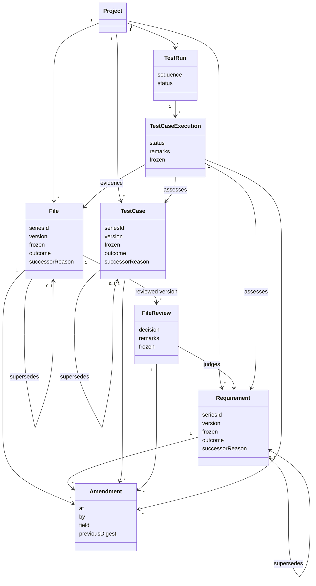

# Iterations

Phases are ignored.

## Overview

A file, requirement, or test case is versioned on its own. The user chooses, on that item:

- **Update** replaces the current version (same token). Use this while that version is still the working copy.
- **New version** freezes the current version and creates the next one in the same series. Use this when the current version must stay as the record: a review approved or rejected it, a closed test execution cites it, or the user wants that history kept.

There is no project iteration that freezes or forks every item together. One rejected file becomes version 2. An approved neighbour stays version 1. `seriesId` is the token of version 1. `supersedes` links the new version to the frozen one. The reason is `not_accepted`, `content_changed`, or `explicit`.

Two checks on files are not test runs.

**Dossier completeness** asks whether the required files are there. The expected set is the file-structure checklist (`structure.meta.completeness`). A mandatory slot with a `HAS_LINK` is present. An empty slot is missing. The result does not read the file, does not approve it, and does not set `verified_in`.

**File content** is a `file_review` of one file version. The reviewer records remarks and a decision: approved, rejected, or re-review. While the review is open, remarks replace that same review. Closing it freezes the review. Approved or rejected also freezes that file version. Re-review leaves the file editable. The next version gets its own review. The review links the requirement versions it judged.

A test execution stays on the `test_run`. While the run is open, status, remarks, and evidence replace that execution. A retest is a new run and a new execution. A failed execution does not create a new test case, and the run does not decide completeness or file approval. A finding stays the same `register`.

The editor today does not do this. An upload in Items always creates a new `file`. `updateExecutionStatus` always overwrites the execution. The checklist is not in the editor. A `file_review` node does not exist.

## Domain

`outcome` on a file is the decision of its latest closed review: Approved, Rejected, or still open (Submitted, In Review). An execution is `Gepasseerd`, `Gefaald`, or `Niet uitgevoerd`. Completeness is not a field on the file. It is the checklist result for the structure.

The dossier slot stays one node. Its current `HAS_LINK` points at the head `file`. Older files are reached through `supersedes`.

## Operations

| Operation | Effect |
|-----------|--------|
| `evaluateCompleteness` | Reads the file-structure checklist. Reports each mandatory slot as present or missing. Creates no review, no test run, and no execution. Does not set `verified_in` or file `outcome`. |
| `updateVersion` | Replaces content of the head file, requirement, or test case. Same token. Appends an amendment. Refused when the version is frozen. |
| `supersede` | Freezes the head and creates the next version with a reason. A new file starts empty and the slot link moves to it. A new requirement or test case starts from a copy of the current text. |
| `openFileReview` | Creates a `file_review` on one file version and the requirement versions being judged. |
| `updateFileReview` | Replaces remarks on that review while it is open. Appends an amendment. |
| `closeFileReview` | Freezes the review. Approved or Rejected sets the file `outcome` and freezes that version. Re-review leaves the file editable. |
| `overrideResult` | Replaces status, remarks, or evidence of an execution while its run is open. Same token. Appends an amendment. |
| `openTestRun` | Creates a `test_run` and a new execution for each selected case. Does not version the test case or the files. |
| `closeTestRun` | Freezes the executions of that run. A file version cited by one of those executions freezes too. |

## Invariants

- `updateVersion` applies only to the head version, and only while it is not frozen.
- A version freezes when it is superseded, when a review of it is Approved or Rejected, or when an execution in a closed run cites it.
- A version has at most one successor.
- A `file_review` belongs to one file version. `updateFileReview` applies only while that review is open.
- Completeness does not write file `outcome`, `verified_in`, a review, or a test execution.
- A `test_case_execution` belongs to one `test_run`. `overrideResult` applies only while that run is open.
- An execution keeps the file, requirement, and test-case tokens it assessed. Those tokens freeze with the execution.
- The slot has one current `HAS_LINK`, to the head file.

## User stories

Mockups: [HTML screens](../../../static/mockups/iterations/items-working.html).

### US-IT01 – Update the current version {#us-it01}

**As a** contractor  
**I want** to replace the content of the current file, requirement, or test case  
**so that** a correction of the working copy does not create a second document.

**Domain:** `updateVersion`  
**Mockup:** [Items drawer, working copy](../../../static/mockups/iterations/items-working.html)

**Acceptance criteria**

- **Update this version** on an unfrozen head keeps the token.
- For a file, the stored content is replaced. The drawer lists it under **Replaced in this version**.
- For a requirement or test case, **Save** writes the same node.
- The Structure slot stays on that file ([Structure slot](../../../static/mockups/iterations/structure-completeness.html)).
- **Update this version** is absent when the version is frozen.

---

### US-IT02 – Issue a new version {#us-it02}

**As a** contractor  
**I want** to choose a new version of this file, requirement, or test case  
**so that** the version that was checked stays unchanged.

**Domain:** `supersede`  
**Mockup:** [Items drawer, frozen version](../../../static/mockups/iterations/items-frozen.html)

**Acceptance criteria**

- **New version** asks for `not_accepted`, `content_changed`, or `explicit`, then creates the next head and freezes the current one.
- A new file starts empty. The slot `HAS_LINK` moves to it. The previous file stays the predecessor.
- A new requirement or test case starts from a copy of the current text.
- When a review has Approved or Rejected the version, or a closed run cites it, only **New version** is offered.
- Without a reason, the action stays disabled.

---

### US-IT03 – See whether the required files are there {#us-it03}

**As a** dossier manager  
**I want** to check the file structure against its checklist  
**so that** I know which mandatory documents are missing, without treating that as a test or an approval.

**Domain:** `evaluateCompleteness`  
**Mockup:** [Dossier completeness](../../../static/mockups/iterations/structure-completeness.html)

**Acceptance criteria**

- **Check dossier** on the Structure tab lists each mandatory slot as Present or Missing.
- Present means the slot has a `HAS_LINK` to a file. Missing means it does not.
- The result does not create a `file_review`, a `test_run`, or a `test_case_execution`.
- The result does not change file `outcome` or `verified_in`.
- A Present file can still be Rejected by a later review.

---

### US-IT04 – Review the content of one file version {#us-it04}

**As a** reviewer  
**I want** to record a decision on this file version  
**so that** the review stays attached to the version I read.

**Domain:** `openFileReview`, `updateFileReview`, `closeFileReview`  
**Mockup:** [File review](../../../static/mockups/iterations/file-review.html)

**Acceptance criteria**

- **Start review** on a file creates one `file_review` for that version.
- Saving remarks updates that review while it is open.
- **Close review** with Approved or Rejected freezes the review and that file version, and sets the file `outcome`.
- **Close review** with Re-review freezes the review and leaves **Update this version** available.
- The closed review remains on that version after **New version**. The new file has no review until **Start review**.
- The Test Run tab does not list this review.

---

### US-IT05 – Correct an execution inside the open run {#us-it05}

**As a** tester  
**I want** to change status and evidence while the run is open  
**so that** a correction is this execution, not a new one.

**Domain:** `overrideResult`  
**Mockup:** [Open test run](../../../static/mockups/iterations/test-run.html)

**Acceptance criteria**

- The inline status dropdown writes `Gepasseerd`, `Gefaald`, or `Niet uitgevoerd` on the same execution token.
- **Upload file** and **Add selected file** replace the evidence of that execution.
- **Close run** disables both. The closed run stays readable and refuses further changes.
- Closing the run does not set file `outcome` and does not fill a missing dossier slot.

---

### US-IT06 – Retest in a new run {#us-it06}

**As a** tester  
**I want** a failed test to be executed again as a new execution  
**so that** the closed run remains the record of the previous attempt.

**Domain:** `openTestRun`  
**Mockup:** [Test run cards](../../../static/mockups/iterations/test-run-cards.html)

**Acceptance criteria**

- **Add Test Run** creates a run and a new execution per selected case. Default selection is `Gefaald` and `Niet uitgevoerd`.
- The new execution starts as `Niet uitgevoerd`. The previous execution is unchanged.
- The test case and the cited files stay the same versions, unless the user has issued a new version from Items.
- A `Gepasseerd` execution is not copied into the new run.
