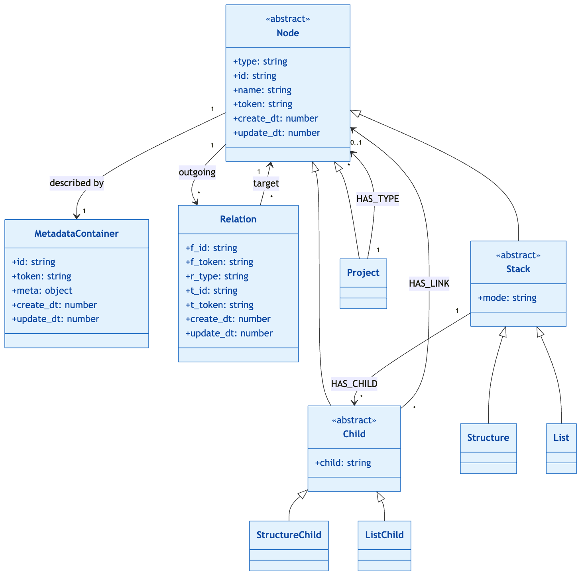
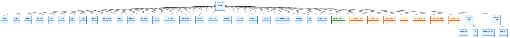
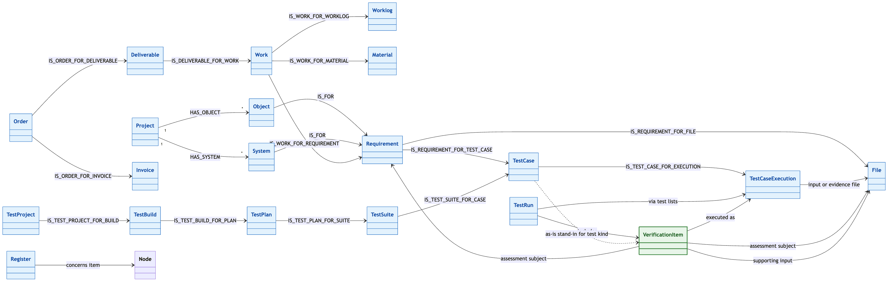
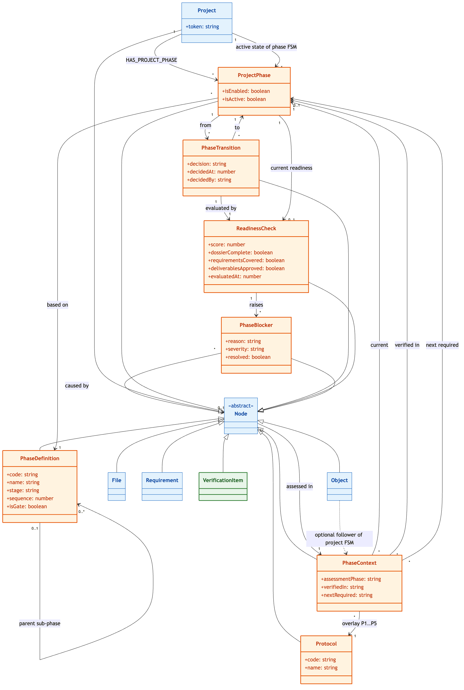
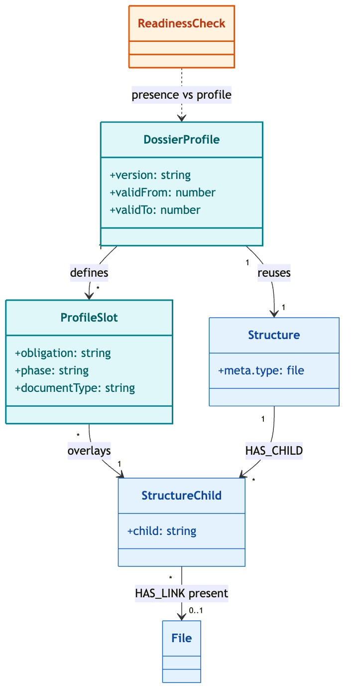
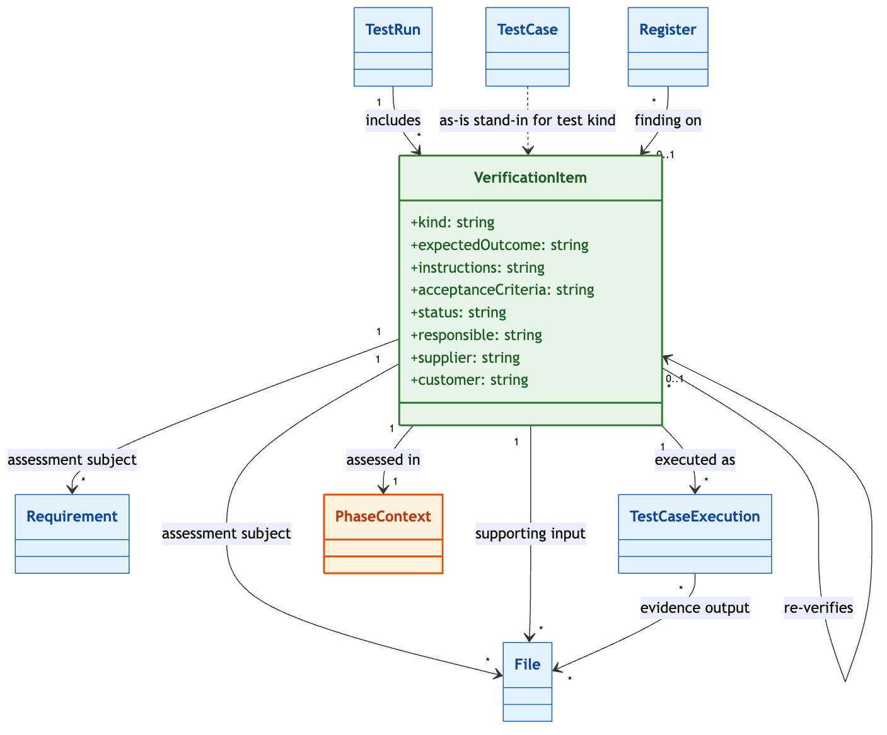

# Domain Model


This page documents the VNV domain model.

For a hands-on walkthrough (tokens, scenarios, present vs verified, UI → writes), see [Domain model – practical guide](domain-model-practical.md).

The domain is technically implemented as a directed graph. Every business item is a **Node**. Nodes are described by a **MetadataContainer**, connected by **Relations**, and optionally organised in **Structures** and **Lists**.

This is documented in [Core metamodel](#core-metamodel). 

**As-is** (blue) is the model as implemented today. Node types and prefixes come from the SDK node definitions (`project` / `PR`, `requirement` / `REQ`, and so on).

**To-be / Epic 1** (orange) adds **phase**, **phase context**, and **transitions**: configurable phases as a **project-level finite state machine** (exactly one active phase), per-item phase context, and gated go/no-go moves with readiness and blockers.

**To-be / Epic 2** (teal) reuses the as-is **file Structure** as the dossier profile: expected slots, presence via `HAS_LINK`, P5 completeness. 

**To-be / Epic 4** (green) adds **VerificationItem** as the planned check (review, inspection, analysis, test, witness, validation). Until it is implemented, TestCase and TestCaseExecution remain the stand-in.

Later-epic shaping (file **input** vs **output/evidence** roles, requirement kind, file iteration) is written into the class notes, operations, and invariants below so Epic 1 does not assume “every file is verified” or “every check is a behavioural requirement.”

| Colour | Meaning |
|--------|---------|
| Blue | As-is — implemented node types |
| Orange | To-be — Epic 1 (phases, phase context, transitions) |
| Teal | To-be — Epic 2 (dossier profile via file Structure) |
| Green | To-be — Epic 4 (verification items) |

---

## Core metamodel





Three relation families are used:

| Family | Pattern | Meaning |
|--------|---------|---------|
| Belonging | `HAS_{TYPE}` | Always from **Project** to a node of that type |
| Logical link | `IS_{A}_FOR_{B}` | Typed association between two nodes, often stored as a pair |
| Organisation | `HAS_CHILD`, `HAS_LINK` | Stack → child, then child → linked node (`HAS_LINK` may cross projects) |

The **token** is the canonical identifier (`PR2024-008`, `REQ2024-008-042`). Hierarchy in a structure is not extra relations: it is the dotted `child` value (`1`, `1.1`, `1.1.1`).

---

## Node types





---

## Domain associations





As-is today stores a single `IS_TEST_CASE_EXECUTION_FOR_FILE` edge. To-be splits that into **input** vs **output/evidence** roles on the execution (or verification item); see [Verification subjects and file roles](#verification-subjects-and-file-roles) and [Epic 4 – Verification items](#epic-4-verification-items).

---

## Epic 1 – Phases, phase context and transitions

The project's phase lifecycle is a **finite state machine (FSM)** whose **authority sits on the Project**:

| FSM element | Model |
|-------------|--------|
| Possible states | Enabled **ProjectPhase** rows (subset of the **PhaseDefinition** catalog) |
| Current state | Exactly one ProjectPhase with `isActive = true` (or none before start) |
| Transition | **PhaseTransition** from active phase P to next enabled phase P′, decided **go** or **no-go** |
| Guard | **ReadinessCheck** + no unresolved critical **PhaseBlocker** |

That active phase is a gate: leaving it needs go/no-go, readiness, and a clear view of blockers.

**Object** (as-is SOI / product node) is **not** the authority of the FSM. A project may own several Objects; they share the **same** project phase state. Object may still carry a **PhaseContext** as a follower (updated on start/go) for UI and history — never as a second source of truth for “which phase is active.”

> **Out of scope (later):** independent phase FSMs per Object when multiple SOIs must progress at different paces. That would move `isActive` (or equivalent) onto Object and require mandatory Object↔Requirement links to resolve P on verify.

Phase context is visible on dossier, file, requirement, Object, and verification item: current assessment phase, phases already verified, next phase still required. **Protocol** (P1..P5) is an overlay on the same phase, not a second FSM. How operations write PhaseContext, and the rules they must keep, are listed under [Domain operations](#domain-operations) and [Invariants](#invariants).





Standard catalog: VO, DO, UO (design), FAT, SAT, SIT, UAT/OAT (integration). FAT may split into FAT Software and FAT Hardware via `PhaseDefinition` parent. Protocol codes: P1 Design, P2 Integration, P3 Onboarding, P4 Escalation, P5 Dossier.

### Verification subjects and file roles

On verification actions, the `verified_in` of the relevant objects (requirement, document, deliverable, ...) registers the current phase of the project as the fase in which the item was verified.

Not all checks result in a change of `verified_in` phase for files:

- The readiness check wether a dossier is complete, does not result in a change of `verified_in` phase.
- A verification item where a file is the **assessment subject** of the verification item will potentially update the `verified_in` of the document being reviewed. This type of review assesses if the document is correct and complete.

A file can thus be used as evidence, or as assessment subject of a verification.

**File** remains a single node type. Input (assessment) vs output (evidence) is a **role on the link** to a verification item or execution (SHIPOC input / output), not `InputFile` / `OutputFile` subclasses. The same File may be evidence of one check and an input subject of another later.

| Role on VI / execution | Meaning | On pass |
|------------------------|---------|---------|
| **Input (assessment subject)** | Deliverable being judged by this check | May update that File’s `verified_in` |
| **Input (supporting)** | Source used to perform the check, not itself under approval | No File `verified_in` from this execution |
| **Output / evidence** | Produced by the execution (review report, log, photo, witness sheet) | Never writes File `verified_in` |

Not every File needs a verification item. Evidence and supporting inputs do not. 

Profile presence does not create a verification item.

A verification item must have at least one **assessment subject**: one or more **Requirements** and/or one or more **Files**. Requirement **kind** distinguishes system/behavioural obligations from process/deliverable/documentation obligations so coverage metrics and gates do not treat them alike.

```text
Profile --> presence / readiness (P5)

File (deliverable) --> document-review VI --> CCC execution --> File verified_in
                    |-> optional process/deliverable REQ

System REQ --> review / analysis / test VI --> execution --> REQ verified_in
            |-> File as supporting input or evidence (optional)
```

---

## Epic 2 – Dossier profile via file Structure {#epic-2-dossier-profile}

The dossier profile is **not** a new File subtype. Reuse the as-is **Structure** with `meta.type: file`: a tree of expected document slots (`structure_child`). That is the first path above (presence / P5).

- An empty slot (no `HAS_LINK`) is **missing**.
- A slot with `HAS_LINK` to a **File** is **present**.
- As-is `structure.isComplete()` is the starting point for `ReadinessCheck.dossierComplete`.
- Presence of a file does **not** create a verification item and does **not** update the File's `verified_in`.

Structure children have no metadata today. Epic 2 adds a **slot overlay** (on the child or a small profile record pointing at the Structure): obligation, applicable phase, document type. The live file tree stays the dossier instance; the overlay is the specification.





| Overlay | Meaning |
|---------|---------|
| **obligation** | mandatory / optional / excluded (project override of the baseline) |
| **phase** | which ProjectPhase this slot applies to (one tree can serve several phases) |
| **documentType** | type to match, not merely “a file sits in this folder” |
| **version / validity** | which profile applied at a given time; completeness always uses the **active** profile for that project and phase |

The **baseline** is a file Structure in a template (per project type). Onboarding **copies** it into the project (protocol P3). The project may add slots, make them optional, or exclude them. Completeness is evaluated against that active profile, not against “whatever files happen to be in the tree.”

---

## Epic 4 – Verification items {#epic-4-verification-items}

A **verification item** is the smallest manageable verification unit: the planned check that links subject, method, execution, and evidence. Not every requirement is verified by a test. Kinds include document review, inspection, analysis, test, witness test, validation scenario, and defect re-verification.

Until this type is implemented, **TestCase** + **TestCaseExecution** remain the as-is stand-in. A **TestRun** groups executions of one or more verification items in a phase.

SHIPOC is mandatory on the item: **Supplier** and **Customer** are attributes; **Hierarchy** is PhaseContext; **Input** and **Output** are [link roles](#verification-subjects-and-file-roles) on Files (and Requirements as assessment subjects); **Process** is the execution instructions.





| Kind | Typical assessment subject | Execution | Evidence | Decision |
|------|----------------------------|-----------|----------|----------|
| Document review | File (deliverable), optional process/deliverable REQ | Reviewer CCC | Review report | Approved / Adjust / Re-review |
| Inspection | File, Requirement | Check against procedure | Inspection report, checklist | Conform / Non-conform |
| Analysis | Requirement, calculation/simulation File | Substantive check | Analysis report | Accepted / Re-analysis |
| Test | Requirement (system/behavioural) | TestCaseExecution | Logs, measurements | Passed / Failed / Blocked |
| Witness test | Requirement, procedure File | Observed execution | Signed witness report | Accepted / Not accepted |
| Validation scenario | Requirement (fit for use) | E2E scenario | Scenario result | Fit for use / Adjust |
| Defect re-verification | Original VI, Register finding | Targeted recheck | Retest result | Closed / Reopen |

Traceability to keep on every item: which requirement version is covered, which File roles were used, which execution(s) ran, and the result plus rationale. CCC (completeness, compliance, correctness) is applied per item; a dedicated CCC assessment type is still a later epic.

---

## Classes

### As-is — graph core

**Node** — Abstract graph entity: type, token, name, id, and timestamps. Every domain item is a node.

**MetadataContainer** — Typed property bag attached to a node by token (status, dates, quality, file info, external refs). Kept separate from the node fragment.

**Relation** — Directed edge from one node to another (`f_token` → `t_token`) with a typed `r_type` (`HAS_*`, `IS_*_FOR_*`, `HAS_CHILD`, `HAS_LINK`).

**Stack** — Abstract organisational view over nodes, independent of project belonging. Specialised as a hierarchical Structure or a sequential List.

**Child** — Abstract position inside a stack. The `child` field encodes order or tree path; a leaf may `HAS_LINK` to a domain node.

**Structure** (`STR`) — Hierarchical stack (tree). Nesting is the dotted `child` path (`1.2.1`); only leaves link to nodes. When `meta.type` is `file`, the tree organises File nodes and is reused as the [dossier profile](#epic-2-dossier-profile).

**List** (`LST`) — Ordered sequential stack. Children are a flat sequence (`1`, `2`, `3`), each optionally linked to a node.

**StructureChild** (`structure_child`) — One node in a structure tree, placed by its `child` path.

**ListChild** (`list_child`) — One slot in a list sequence, placed by its `child` index.

### Project and organisation

**Project** (`PR`) — Root container of the graph. Owns every project node through `HAS_{TYPE}` and may nest under another project via `parent` / `master`. **Authority of the phase lifecycle FSM:** enabled `ProjectPhase` rows and exactly one `isActive` current state (or none before start).

**Object** (`OBJ`) — Business object or product of the project (the system of interest in as-is language). Status: Finaal / Niet Finaal. Not the phase FSM authority; optional PhaseContext **follows** the project's active phase on start/go.

**System** (`SYS`) — Technical or functional system (or subsystem) inside the object.

**Contact** (`CNT`) — Project stakeholder or contact person, with internal/external responsible fields.

**Role** (`ROL`) — Named role in the project (who is allowed to do what), not a login account.

**Group** (`GRP`) — Team or working group used to organise people and access.

**User** (`USR`) — Platform user (name, email, UPN, groups), typically synced from the identity directory.

**Report** (`REP`) — Generated or stored project / V&V report.

### Delivery and commercial chain

**Order** (`PO`) — Purchase order or assignment: period, estimates, budget year, and content.

**Deliverable** (`DEL`) — Contractual deliverable allocated to an order. Status: Gealloceerd / Niet gealloceerd.

**Work** (`WRK`) — Work package or task that realises a deliverable and can be linked to requirements.

**Worklog** (`WRKLG`) — Time or cost entry recorded against a work item.

**Material** (`MAT`) — Physical resource or material, with purchase status and estimated cost.

**Invoice** (`INV`) — Invoice (or progress bill) on an order, with a billing-cycle status.

**Attachment** (`ATT`, type `attachement`) — Cost/time-bearing attachment linked to a delivery item.

### Requirements, quality, and registers

**Requirement** (`REQ`) — Obligation under assessment, with SMART status, author, category, content, and CCC / RAT quality fields. **Kind** (to-be) at least: **system / behavioural** (SOI behaviour or design satisfaction) vs **process / deliverable / documentation** (e.g. mandatory approved architecture document, SRS quality). System-requirement coverage metrics ignore process/deliverable requirements (counted separately for dossier/process readiness).

**Register** (`REG`) — Cross-cutting log: action, question, decision, risk, invoice/progress note, or generic log, with category-dependent status.

### Tests and V&V

**TestProject** (`TPRJ`) — Test campaign or validation project scoped to a (product) project.

**TestBuild** (`TBLD`) — Build or release under test.

**TestPlan** (`TPLN`) — Test plan for a build (scope, approach, validation type).

**TestSuite** (`TSUI`) — Thematic grouping of test cases inside a plan.

**TestCase** (`TCAS`) — Test scenario that can cover a requirement. Status: Revisie / Klaar voor test; `testType` 1A–4. As-is stand-in for a **test**-kind [VerificationItem](#epic-4-verification-items).

**TestCaseExecution** (`TCEX`) — One run of a test case (and, until Epic 4 is implemented, of a verification item). Status: Niet uitgevoerd / Gepasseerd / Gefaald. Linked Files are **inputs** and/or **evidence outputs** (as-is: one relation type; to-be: explicit roles). Stamp the requirement version and file version on the execution.

**TestRun** (`TRN`) — Execution campaign that groups case and execution lists, and to-be groups verification items in a phase. Status: not / partly / fully executed.

### Documents

**File** (`FIL`) — Document or binary in the dossier (type, size, digest, URL, live view, CCC flags, tags). One node type for all binaries. Whether a File is an assessment subject, supporting input, or evidence is determined by its **role on a verification item / execution**, not by subclass. Optional metadata hint (e.g. deliverable vs evidence) must not replace the link role.

**Annotation** (`ANN`) — Lightweight titled note attached in the graph.

### Epic 1 – Phases (to-be)

**PhaseDefinition** — Catalog entry for a lifecycle state (VO, DO, UO, FAT, SAT, SIT, UAT/OAT), with stage, sequence, gate flag, and optional parent for sub-phases such as FAT Software. Shared across projects; not itself the FSM instance.

**ProjectPhase** — A catalog phase **enabled on a project** (an allowed FSM state). Exactly one ProjectPhase may have `isActive = true` — that is the project's current FSM state.

**PhaseContext** — Per-item phase view on any phase-scoped node (document, requirement, verification item, Object, …): current assessment phase, phases already verified, next phase still required. Written by domain operations, not edited as a standalone form. For **File**, `verified_in` means formal review/approval in that phase — never mere upload or use as evidence. PhaseContext is **not** the project FSM authority.

**Protocol** — Orthogonal overlay P1..P5 (design, integration, onboarding, escalation, dossier) on the same phase, not a second FSM.

**PhaseTransition** — Formal FSM transition from the active ProjectPhase to the next enabled phase, with an explicit go/no-go decision, actor, and timestamp.

**ReadinessCheck** — Evaluation of whether a gate may be passed (transition guard). Aggregates at least: **dossier completeness** (profile presence, P5), **system requirements coverage / verification**, **deliverable approvals** where required (File `verified_in` for mandatory assessment subjects), open critical blockers / P4 findings, and an overall readiness score. Presence and behavioural verification are separate criteria.

**PhaseBlocker** — Open condition that prevents a transition until resolved (for example unverified critical requirements or missing mandatory documents), optionally pointing at the causing node.

### Epic 2 – Dossier profile (to-be)

**DossierProfile** — Specification of expected documents for a project (and phase). Reuses one as-is **Structure** (`meta.type: file`). Holds **version** and **validity** so completeness is always evaluated against the active profile. Baseline comes from a template Structure which the project may override.

**ProfileSlot** — Overlay on a `structure_child`: **obligation** (mandatory / optional / excluded), **phase**, **documentType**. Empty child (no `HAS_LINK`) = missing; `HAS_LINK` to a File = present. Presence never writes `verified_in`. See [Epic 2 – Dossier profile via file Structure](#epic-2-dossier-profile).

### Epic 4 – Verification items (to-be)

**VerificationItem** (`VI`, type `verification_item`) — Planned check: the formal execution and decision unit. Attributes: **kind** (document review, inspection, analysis, test, witness test, validation scenario, defect re-verification), expected outcome, execution instructions, acceptance criteria, status, responsible party, SHIPOC **supplier** and **customer**. **Hierarchy** is PhaseContext. **Input** / **output** are File (and Requirement) link roles, not subclasses.

Owned by the project through `HAS_VERIFICATION_ITEM`. Logical links: assessment subject to **Requirement** (`IS_VERIFICATION_ITEM_FOR_REQUIREMENT`) and/or **File** (`IS_VERIFICATION_ITEM_FOR_FILE` with role assessment subject); supporting input File (same relation type, role supporting); executions via **TestCaseExecution** (as-is stand-in); optional `re-verifies` to another VerificationItem; findings on **Register**. At least one assessment subject is required. See [Epic 4 – Verification items](#epic-4-verification-items).

---

## Domain operations

Operations are the only way the model changes. **PhaseContext is a side effect**: create, link, execute, and transition write it; users do not set `current` / `verified_in` / `next required` by hand.

**VerificationItem** is a first-class to-be type (Epic 4). Until it is implemented, **TestCase** + **TestCaseExecution** remain the stand-in for “add / execute verification item” (test kind only). Domain operations on test case executions still write the PhaseContext and readiness side effects in the first version.

**P** is the project's **current FSM state** (the unique active ProjectPhase) at the moment of the operation. **P′** is the next enabled phase (the go target). On successful verification of an assessment subject, `verified_in` gains **P** from that project active state — not from an Object lookup. Users never edit PhaseContext by hand; the operations below write it.

**Covered** in P means a verification item or test case is linked for P as assessing that subject. **Verified** in P means `verified_in` contains P — only after a successful execution against that assessment subject. **Present** in the dossier (profile match) is not verified.

### Phase-scoped types

These types have a **PhaseContext**. All other types (contact, role, group, user, order, deliverable, invoice, material, report, annotation, stacks, children, …) do not.

| Type | What `current` means | What `verified_in` means | What `next required` means |
|------|----------------------|--------------------------|----------------------------|
| **Object** (product / SOI node) | Follows the project's active ProjectPhase (side effect of start/go; not FSM authority) | Phases already completed for the project (**go** transitions) while this Object was in scope | Next enabled phase, or ∅ at the last phase |
| **Requirement** | Phase in which this requirement version is being assessed | Phases in which the requirement was successfully verified (P = project active state at pass) | Next phase that still needs a check, or P while still open |
| **File** | Phase in which this document version is being assessed **as a deliverable** (if it is an assessment subject), evidence-only files may still carry PhaseContext for dossier tracking but are not driven to `verified_in` by executions that only attach them as evidence | Phases in which the document was successfully **approved/reviewed as assessment subject** | Next phase that still needs a dossier **approval** check, or P while still open; profile presence alone does not clear this |
| **VerificationItem** | Home phase of this check (the phase it belongs to) | Phases in which **this check** has a passing execution (usually only P) | ∅ after pass; P after fail/blocked (re-run) |
| **TestCase** | Home phase of this case | Phases with a passing execution of this case | ∅ after pass; P after fail/blocked |
| **TestCaseExecution** | Phase in which this run happened | {P} if this run passed; ∅ otherwise | n/a (an execution is a point in time) |
| **TestRun** | Phase of the campaign | ∅ until the run is fully passed; then {P} | P while incomplete |
| **TestProject / TestBuild / TestPlan / TestSuite** | Phase in which this test artefact is being prepared or used | ∅ until the artefact is accepted for that phase | P while not accepted |
| **Register** (finding) | Phase in which the finding was raised | ∅ (a finding is not “verified”); closed in P via register status | P while open |

The **Project** itself has no PhaseContext node. The phase FSM **is** the set of ProjectPhases plus `isActive`. Item PhaseContexts reference those ProjectPhases.

Default **protocol** on create is the happy path for that stage (P1 in design, P2 in integration). Escalation sets **P4**. Dossier completeness sets **P5**. Template publish / onboarding sets **P3**. Protocol never changes the active ProjectPhase (it does not fire an FSM transition).


### Dossier profile and onboarding (to-be)

- **The dossier profile is configured or overridden.** The project’s file Structure is the expected tree. Slot overlay sets obligation, phase, and document type. No PhaseContext on the profile itself.
- **Dossier completeness is evaluated** (presence vs profile). A mandatory slot without `HAS_LINK` is missing. `structure.isComplete()` is the as-is starting point. The ReadinessCheck sets `dossierComplete` and may raise PhaseBlockers for missing slots. Protocol is P5. No File gets `verified_in` from presence alone.
- **A mandatory slot is empty.** That expected File stays unverified (`verified_in` unchanged). `next required` gets P. Protocol is P5.
- **A file is linked into a profile slot.** The slot is **present**. File `verified_in` does not change.
- **A template pack is published (onboarding).** The baseline file Structure is copied into the project (protocol P3). Each seeded Requirement, File, and VerificationItem: `current` gets P; `verified_in` is empty; `next required` gets P if the item is an assessment subject.

### Create and link

- **A requirement is created.** `current` gets the project's active phase P. `verified_in` is empty. `next required` gets P (still to verify). Protocol gets the default for P.
- **A file is created.** `current` gets P. `verified_in` is empty. If the file is expected as a deliverable assessment subject, `next required` gets P. If it is evidence-only until linked, `next required` is not driven by this create. Protocol gets the default for P (P5 if created under dossier-completeness work).
- **A finding is raised (register).** `current` gets P. `verified_in` is empty. `next required` gets P while the finding is open. Protocol is P4 if this is an escalation, otherwise the default for P.
- **A test project, build, plan, or suite is created.** `current` gets P. `verified_in` is empty. `next required` gets P. Protocol gets the default for P.
- **A test case is created.** `current` gets P. `verified_in` is empty. `next required` gets P. Protocol gets the default for P.
- **A test run is created.** `current` gets P. `verified_in` is empty. `next required` gets P. Protocol gets the default for P.
- **A verification item is created** (at least one Requirement and/or File as assessment subject). On the **VerificationItem**: `current` gets P; `verified_in` is empty; `next required` gets P. Protocol gets the default for P (P4 if deviation, P5 if dossier document-review). On each **assessment subject** (Requirement or File): `current` and `verified_in` stay as they were — the subject is now **covered** in P, not verified.
- **A supporting input or evidence file is linked** to a verification item or execution. The File's PhaseContext does not change. It is not covered and not verified by that link.
- **A requirement is linked to a file** for traceability (not a VI role). PhaseContext on both stays as it was.
- **A requirement is linked to a test case or verification item.** PhaseContext stays as it was. Coverage comes from the VI/test having that requirement as assessment subject.
- **The last passing verification item or test case for phase P is unlinked** from a requirement (and from a file if that file was an assessment subject of the check). That subject's `verified_in` loses P. `next required` gets P if the subject is still open.

### Execute

Here P is the **home phase** of the verification item or test case (`current` on that item). That is normally the project's active phase when the item was created.

Stamp the **requirement version** and **file version** on the execution for each linked subject and evidence File. PhaseContext does not store versions; the execution does. Evidence is attached as **output** Files; that attachment alone never verifies those Files.

- **A verification item or test case passes.** On the **VerificationItem / TestCase**: `verified_in` gets P; `next required` becomes empty. On the **execution**: `current` gets P; `verified_in` is {P}. On each **Requirement** that is an assessment subject: `verified_in` gets P; `next required` becomes the next phase after P, or empty. On each **File** that is an **assessment subject**: the same (`verified_in` gets P; `next required` becomes the next phase after P, or empty). Supporting input Files and evidence output Files do not change.
- **A verification item or test case passes with remarks.** Same as pass for `verified_in` on the item and its assessment subjects. On the VerificationItem, `next required` becomes empty. A subject may keep `next required` = P if the remarks still require follow-up.
- **A verification item or test case fails.** On the **VerificationItem / TestCase**: `verified_in` does not get P, and loses P if a previous pass in P is now invalid; `next required` gets P. On the **execution**: `verified_in` is empty. On each **Requirement / File assessment subject**: `verified_in` loses P if this was the last valid pass in P; `next required` gets P.
- **A verification item or test case is blocked.** On the **VerificationItem / TestCase**: `verified_in` stays as it was; `next required` gets P. On each **assessment subject**: `next required` gets P. A **PhaseBlocker** is raised, caused by the item or a missing input.
- **A verification item or test case is re-executed.** The latest valid result for P wins. Apply the same pass, fail, or blocked rules as above.
- **A test run is closed with all cases passed.** On the **TestRun**: `verified_in` gets P; `next required` becomes empty.
- **A test run is closed incomplete or failed.** On the **TestRun**: `verified_in` stays as it was; `next required` gets P.

### Readiness, blockers, transitions

- **Readiness is evaluated.** The ReadinessCheck reads PhaseContext, profile presence, and open P4 findings, and writes score flags. It does not write `verified_in` on any subject.
- **A blocker is raised or resolved.** No PhaseContext change on subjects.
- **A phase transition is requested.** A PhaseTransition is recorded from P toward P′. PhaseContext is not rewritten yet.
- **No-go is decided.** Nothing changes. The project's active ProjectPhase and all item PhaseContexts stay as they were.
- **Go is decided.** The project FSM transitions: deactivate P, activate P′.
  - **Object** (if it has PhaseContext): `current` becomes P′. `verified_in` gets P (P completed for the project while this Object was in scope). `next required` becomes the next phase after P′, or empty. Protocol gets the default for P′.
  - **Requirement or File already verified in P:** `current` becomes P′. `verified_in` history is kept. `next required` becomes the next phase after P′, or P′. Protocol gets the default for P′.
  - **Requirement or File not verified in P** (non-critical leftover): `current` stays P (lags the project FSM). `verified_in` stays as it was. `next required` stays P.
  - **Verification item or test case that passed** (home phase P): `current` stays P (home phase does not follow the project FSM). `next required` stays empty.
  - **Verification item or test case still open in P:** `current` stays P. `next required` stays P.
  - **Test run or execution:** historical; they keep the phase they ran in.
  - **Register still open:** `current` stays P (lags) or becomes P′ if the finding is carried forward. `verified_in` stays empty. `next required` is P or P′. Protocol stays P4 if this is still an escalation.

---

## Implementation backlog – actions, operations, side effects

UI **actions** call domain **operations**. Operations write graph changes and **PhaseContext** side effects (`current`, `verified_in`, `next required`, `protocol`). Users do not edit PhaseContext by hand.

**Stand-in (v1):** where VerificationItem is not implemented yet, use TestCase + TestCaseExecution for test-kind checks. Same PhaseContext rules apply.

| # | UI action | Domain operation | Side effects | Epic |
|---|-----------|------------------|--------------|------|
| 1 | Configure phase catalog | Upsert PhaseDefinitions | Catalog only; no PhaseContext | 1 |
| 2 | Enable project phases | Create ProjectPhase rows (FSM states) | None active until start | 1 |
| 3 | Start phase FSM (first enabled phase) | Activate first ProjectPhase; optionally init Object PhaseContext as follower | Project: exactly one `isActive`; Object (if any): `current`=P, `verified_in`=∅, `next required`=next or ∅, protocol=default for P | 1 |
| 4 | Configure / override dossier profile | Edit Structure `meta.type:file` + slot overlay (obligation, phase, documentType) | No PhaseContext on profile | 2 |
| 5 | Apply template / onboard pack | Copy baseline file Structure; seed Requirements / Files / VIs (or test stand-ins) | Seeded items: `current`=P, `verified_in`=∅, `next required`=P if assessment subjects, **protocol=P3** | 2 |
| 6 | Link file into profile slot | `HAS_LINK` from structure_child → File | Slot **present**; File `verified_in` unchanged | 2 |
| 7 | Evaluate dossier completeness | ReadinessCheck vs profile (`isComplete` + overlay) | Sets `dossierComplete`; may raise PhaseBlockers for missing mandatory slots; **protocol=P5** on assessed dossier context; **never** writes File `verified_in` | 1+2 |
| 8 | Create requirement | Add Requirement + PhaseContext | `current`=P, `verified_in`=∅, `next required`=P, protocol=default (P1/P2) | 1 |
| 9 | Create file | Add File + PhaseContext | `current`=P, `verified_in`=∅, `next required`=P if deliverable subject else n/a; protocol=default (P5 if under dossier work) | 1 |
| 10 | Create verification item (or test case stand-in) | Add VI/TestCase with ≥1 assessment subject (REQ and/or FIL) | Item: `current`=P, `verified_in`=∅, `next required`=P, protocol=default / P4 if deviation / P5 if dossier review; subjects **covered** in P, not verified | 4 (stand-in: as-is tests) |
| 11 | Link supporting input or evidence file | Link File to VI/execution with role | File PhaseContext unchanged; not covered/verified | 4 |
| 12 | Link requirement ↔ file (traceability) | `IS_*_FOR_*` only | No PhaseContext change | as-is |
| 13 | Raise finding / escalate | Add Register (finding) | `current`=P, `verified_in`=∅, `next required`=P, **protocol=P4** | 1 |
| 14 | Execute VI/test — pass | Create/update execution; stamp REQ/FIL versions | VI/TestCase: `verified_in`+=P, `next required`=∅; execution: `verified_in`={P}; each **assessment subject** REQ/FIL: `verified_in`+=P, `next required`=next or ∅; supporting/evidence Files unchanged | 1+4 |
| 15 | Execute VI/test — pass with remarks | Same as pass | Same `verified_in`; subject may keep `next required`=P if follow-up needed | 1+4 |
| 16 | Execute VI/test — fail | Create/update execution | VI/TestCase: no +P (and −P if prior pass invalid), `next required`=P; execution: `verified_in`=∅; assessment subjects: −P if last valid pass, `next required`=P | 1+4 |
| 17 | Execute VI/test — blocked | Create/update execution; raise PhaseBlocker | VI/subjects: `next required`=P; `verified_in` unchanged on VI | 1+4 |
| 18 | Re-execute VI/test | New execution; latest valid result for P wins | Same as pass/fail/blocked | 1+4 |
| 19 | Close test run (all passed) | Update TestRun | TestRun: `verified_in`+=P, `next required`=∅ | 1 |
| 20 | Close test run (incomplete/failed) | Update TestRun | TestRun: `next required`=P | 1 |
| 21 | Unlink last passing VI/test for phase P | Remove subject link | Subject: `verified_in`−=P; `next required`=P if still open | 1+4 |
| 22 | Evaluate readiness (gate) | ReadinessCheck | Reads PhaseContext, profile presence, open P4; writes score flags; does **not** write subject `verified_in` | 1 |
| 23 | Raise / resolve blocker | Upsert PhaseBlocker | No subject PhaseContext change | 1 |
| 24 | Request phase transition | Create PhaseTransition P→P′ | PhaseContext not rewritten yet | 1 |
| 25 | Decide **no-go** | Record decision | No ProjectPhase / PhaseContext change | 1 |
| 26 | Decide **go** | FSM: activate P′; rewrite item PhaseContexts | Project active = P′; Object follower → P′ + `verified_in`+=P; verified subjects follow; leftovers lag; open P4 registers may stay P4; VI home phase stays P | 1 |

### Not PhaseContext (still implement)

| # | UI action | Domain operation | Notes |
|---|-----------|------------------|-------|
| A | Create project | Root Project | No phase FSM until ProjectPhases + start |
| B | Add non-phase-scoped node | Contact, role, order, … | No PhaseContext |
| C | Update / delete node | Metadata or remove | Delete drops relations + PhaseContext |
| D | Add structure / list child | `HAS_CHILD` / optional `HAS_LINK` | Children have no PhaseContext |

### Explicit non-goals (do not implement as user-editable state)

- Free-form edit of `current` / `verified_in` / `next required` / `protocol`
- App mode switch “Onboarding / Completeness / Escalation”
- Completeness pass writing File `verified_in`
- Evidence or supporting-input links verifying a File
- File replace vs new iteration (deferred)

---

## Invariants

### Graph

1. Every non-project node in a project is owned by exactly that project through `HAS_{TYPE}`.
2. Tokens are unique. A node token encodes type prefix and project identity.
3. `HAS_{TYPE}` originates only from **Project**.
4. `HAS_LINK` from a structure child is allowed only on **leaves** (no further children on that path).
5. A node has at most one **MetadataContainer**.

### Phases and PhaseContext (Epic 1)

6. The **project** has **exactly one** active **ProjectPhase** at any time after start (the current state of the phase FSM). Before start, none is active.
7. The active phase is one of the project's **enabled** ProjectPhases.
8. A ProjectPhase always refers to a **PhaseDefinition**. A sub-phase's parent is another PhaseDefinition (for example FAT Software → FAT).
9. **Protocol** (P1..P5) overlays the same phase; it is not a second FSM and does not change the active ProjectPhase.
10. Every phase-scoped node has one **PhaseContext**. **current** is an enabled ProjectPhase of that project.
11. **verified_in** contains only ProjectPhases for which a **successful** execution exists (pass or pass with remarks) against that node as an **assessment subject** (or, for Object, phases completed by **go**). Create, link, upload, profile presence, and attaching a File as **evidence** never write `verified_in` on assessment subjects.
12. **verified_in** follows the **latest valid** execution for that phase: a later fail or invalidating change removes that phase.
13. **next required** is empty or a later enabled phase in catalog sequence (or the same phase while verification is still open).
14. PhaseContext is updated **only** by the operations above (plus authorised correction). It is not a free-form field. **ProjectPhase.isActive** is the sole authority for “which phase is the project in.”
15. On verify, **P** is resolved from the **project** active phase (or the check's home phase, which was taken from that active phase at create) — not by looking up an Object.

### Verification subjects and files (to-be shaping)

16. A verification item has at least one **assessment subject**: one or more Requirements and/or one or more Files.
17. File participation in a VI/execution is a **link role** (input assessment subject, supporting input, or output/evidence), not a File subtype. The same File may take different roles on different VIs.
18. Not every File requires a verification item. Evidence and supporting inputs do not; dossier **presence** is satisfied via the document profile, not via VI.
19. Requirement **kind** distinguishes system/behavioural from process/deliverable/documentation obligations. System-requirement coverage uses only system/behavioural requirements.

### Transitions

20. A **PhaseTransition** starts from the current active phase and targets the next enabled phase in sequence (no skipping unless the skipped phase is not enabled on the project).
21. **Go** requires a readiness check with **no unresolved critical PhaseBlockers**. Readiness treats profile presence, system-requirement verification, and mandatory deliverable approvals as separate criteria.
22. **No-go** does not change the active ProjectPhase (FSM state unchanged).
23. Formal verification, CCC, and phase-gate decisions happen in this model, not in SharePoint.

---

## Later epics (not yet in this diagram)

Still absent as first-class types: **requirement kind**, **file iteration / baseline**, and **CCC assessment**. Explicit **input** vs **evidence** relation types on executions replace the single as-is file link.

**DossierProfile** is specified as Epic 2: reuse Structure `meta.type: file`, plus a slot overlay. It is not implemented as that overlay yet. P5 presence can already use empty-child vs `HAS_LINK`; obligation, phase, document type, and profile version still need the overlay. **VerificationItem** is in the diagrams as Epic 4 to-be; until then **TestCase** / **TestCaseExecution** are the stand-in.

Requirements per epic: [Epics and requirements](epics/_index.md).
